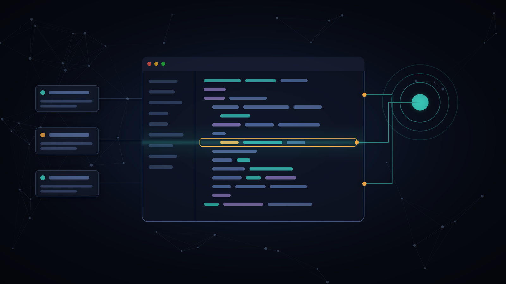
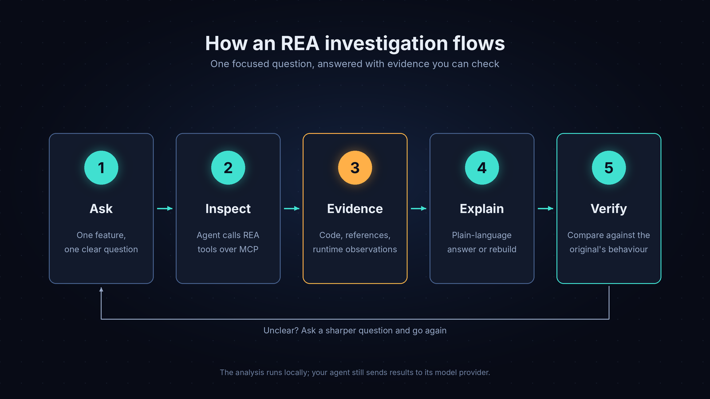
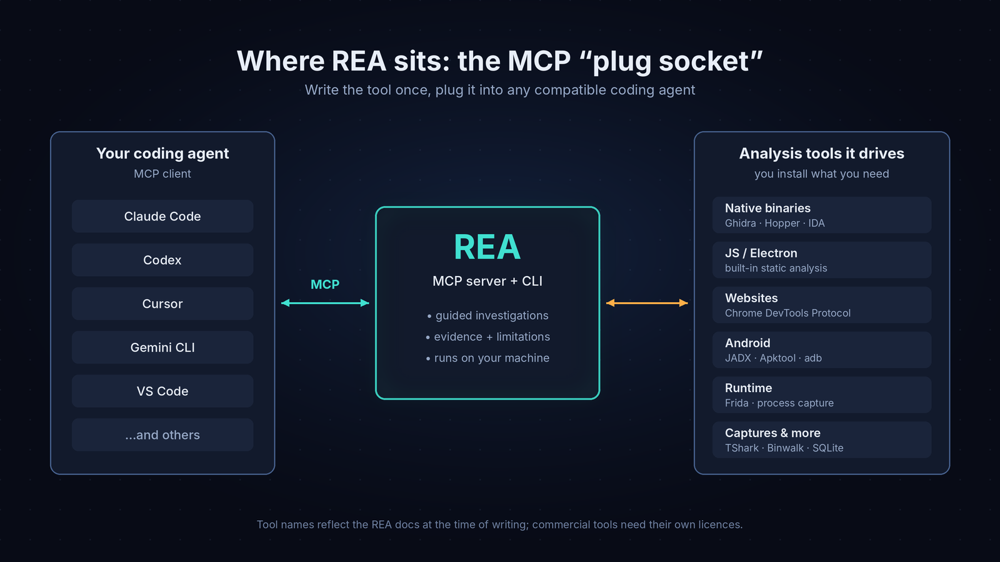

# AI Reverse Engineering with REA



A hands-on companion to my Medium article **[REA: The AI Tool That Can Help You Understand Software Without Its Source Code](https://medium.com/@anjubarai004/rea-the-ai-tool-that-can-help-you-understand-software-without-its-source-code-190c2a2091e9)**.

[REA (Reverse Engineer Anything)](https://rea.tools/) is an open-source MCP server and CLI that lets AI coding agents inspect real software and come back with evidence instead of guesses. This repo gives you a small, safe app to practise on, a step-by-step walkthrough, and a way to **prove** your understanding is correct.

> This is an independent learning project. It isn't affiliated with the REA project. The official sources are [rea.tools](https://rea.tools/) and [github.com/morluto/rea](https://github.com/morluto/rea).

---

## What's inside

| Folder | What it is |
| --- | --- |
| [`demo/invoice-exporter`](demo/invoice-exporter) | A tiny Electron app with one mysterious **Export invoices** button. Its business rules aren't visible in the UI. |
| [`walkthrough/`](walkthrough) | The hands-on exercise: Ask → Inspect → Evidence → Explain → Verify, with real REA output captured from this app |
| [`demo/rebuild/my-exporter.js`](demo/rebuild/my-exporter.js) | A naive "guessed" exporter for you to fix using what REA finds |
| [`demo/scripts/compare.js`](demo/scripts/compare.js) | Checks your rebuild against the original on 200 random invoice batches |
| [`demo/scripts/summarize-rea-output.js`](demo/scripts/summarize-rea-output.js) | Turns REA's ~1 MB JSON evidence into a readable summary |
| [`docs/getting-started.md`](docs/getting-started.md) | Beginner setup for REA and a coding agent |
| [`prompts/example-prompts.md`](prompts/example-prompts.md) | Copy-paste prompts for evidence-based investigations |
| [`article/`](article) | The full article and its diagrams |

## Quick start (5 minutes, Node.js only)

You need **Node.js 22.19+, 24.11+ or 26+**. Electron isn't required.

```bash
git clone https://github.com/Anjub004/ai-reverse-engineering-with-rea.git
cd ai-reverse-engineering-with-rea

# 1. Let REA inspect the demo app (static analysis, nothing is executed)
npx -y rea-agents@latest analyze-javascript-application "$(pwd)/demo/invoice-exporter" --json > rea-output.json

# 2. Read the evidence
node demo/scripts/summarize-rea-output.js rea-output.json

# 3. See how far a "guessed" exporter is from the real one
node demo/scripts/compare.js
```

Then follow the **[walkthrough](walkthrough/README.md)** to fix the rebuild until `compare.js` reports **0 mismatches**.

## What REA found in the demo (real output)

Captured with `rea-agents` 6.7.0. Full output: [`walkthrough/sample-rea-summary.txt`](walkthrough/sample-rea-summary.txt)

```
- [browser-window] BrowserWindow@10:14-18:4  ->  src/main.js:10
- [context-bridge-api] invoiceApi  ->  src/preload.js:5
- [ipc-channel] invoices:export  ->  src/preload.js:7
- [ipc-handler] invoices:export  ->  src/main.js:24
- [ipc-handler] invoices:count  ->  src/main.js:22
```

So the click path is: **button → `invoiceApi.exportCsv()` → IPC `invoices:export` → handler at `src/main.js:24`**, each step backed by a file and line. Following that evidence leads you to the hidden rules.

## How REA fits together





## Responsible use

- The demo app is mine and MIT-licensed, so it's a safe target to practise on.
- Only analyse software you **own or are authorised to examine**. Having a copy of a program doesn't by itself give you permission.
- REA's own [disclaimer](https://github.com/morluto/rea/blob/main/DISCLAIMER.md) excludes bypassing DRM, licence checks or anti-cheat, making cheats, getting around authentication, and copying proprietary code or assets.
- REA doesn't recover original source code, and its output can be incomplete or wrong. Verify anything important, which is exactly what `compare.js` is for.

## Links

- Article on Medium: [REA: The AI Tool That Can Help You Understand Software Without Its Source Code](https://medium.com/@anjubarai004/rea-the-ai-tool-that-can-help-you-understand-software-without-its-source-code-190c2a2091e9)
- REA official site: [rea.tools](https://rea.tools/)
- REA on GitHub: [morluto/rea](https://github.com/morluto/rea)
- Model Context Protocol: [modelcontextprotocol.io](https://modelcontextprotocol.io/)

## Author

**Anju Barai**: [Medium](https://medium.com/@anjubarai004) · [LinkedIn](https://www.linkedin.com/in/anju-barai-3b46b6282) · [Kaggle](https://www.kaggle.com/anju004)

## License

[MIT](LICENSE) for the content of this repository. REA and any third-party tools have their own licences.
