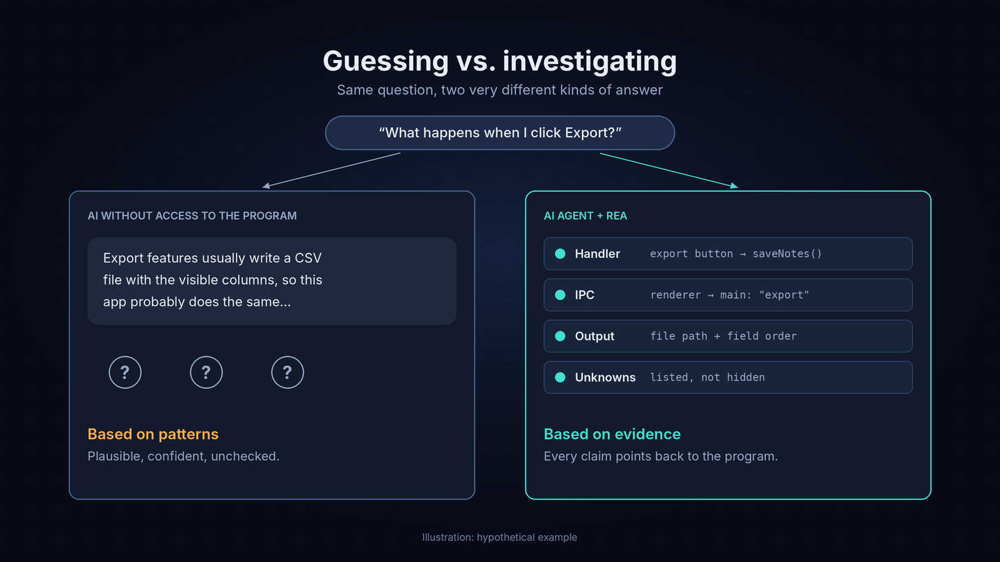
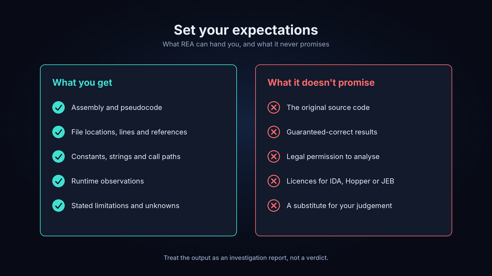

# REA: The AI Tool That Can Help You Understand Software Without Its Source Code

> Originally published on Medium: [REA: The AI Tool That Can Help You Understand Software Without Its Source Code](https://medium.com/@anjubarai004/rea-the-ai-tool-that-can-help-you-understand-software-without-its-source-code-190c2a2091e9)


## Most AI coding tools guess how software works. REA lets your agent look inside and bring back proof.

---

Every company has one of these programs.

It's old. It still does something important. The person who built it left years ago, and nobody can find the source code. Everyone just knows that if you click a certain button, a certain file comes out, and the finance team needs that file every month.

I work in MIS for a retail company, and a lot of what I build sits on top of reports from systems I didn't write and can't see inside. So when I first read about REA, my first thought wasn't "cool AI tool". It was: could this actually tell me what one of those black boxes is doing?

Say you've been asked to replace that old program. Before you write a single line of the new version, you need to know what the old one really does when someone clicks Export. Which fields? In what order? Where does the file go?

You could ask ChatGPT, Claude or Copilot. You'll get an answer, and it'll sound sure of itself. But it hasn't looked at the program. It's telling you how export buttons *usually* work, and "usually" is exactly what gets you in trouble with old software.

That's the gap REA is trying to close.

### The short version

- **What it is:** a free, open-source MCP server and command-line tool that lets AI coding agents inspect real software.
- **Why it matters:** your agent stops guessing and comes back with evidence, like code locations, references and what actually happened at runtime.
- **What it covers:** desktop apps, native binaries, websites, Android apps and more. The analysis runs on your own machine.
- **The catch:** it won't give you the original source code, and it's on you to make sure you're allowed to analyse whatever you point it at.

## So what is REA, exactly?

REA stands for **Reverse Engineer Anything**. The official home is [rea.tools](https://rea.tools/), and the code lives on [GitHub](https://github.com/morluto/rea) under the MIT license. You install it from npm as `rea-agents`.

The README describes it as an MCP server and CLI that connects an AI agent to analysis tools and returns findings along with the evidence behind them. That last part is the whole point.

In practice: you give your agent a program (or a web page) and ask about one feature. REA hands the agent a toolbox for looking inside. The agent comes back with an explanation, plus the files, lines, references and runtime observations it used to get there.

The list of things it can look at is longer than I expected:

- **Native executables and libraries**, through Hopper, Ghidra or IDA if you have one installed
- **JavaScript and Electron apps**, including modules, routes and IPC (how the parts of a desktop app talk to each other)
- **Websites**, using a Chrome-family browser
- **.NET assemblies**, static inspection only
- **Android APKs**, and devices connected over adb
- **Firmware, network captures, SQLite databases** and a few others, some of which need extra tools you install yourself

One thing that confused me at first: there are two websites. [rea.tools](https://rea.tools/) is the official one. [reverseengineeranything.co](https://reverseengineeranything.co/) calls itself an **unofficial fan site**. It has a useful overview, but I'd treat the official site, the GitHub repo and the npm package as the real sources.

## Why your AI assistant can't just tell you

AI coding tools are trained on a huge amount of public code, so they're great at the common case. Ask how a calculator handles the percent key and you'll get a sensible answer.

But sensible isn't the same as correct.

The REA homepage uses that exact example. When REA looked at the library behind Windows Calculator, it found that **%** works differently after **+** than it does after **×**. I didn't know that. I doubt most AI models would guess it either.

That's the real limitation. A model that can't see the program can only predict what software *probably* does. It can't tell you what this specific version of this specific app does. When the behaviour is odd or undocumented, which is basically the definition of legacy software, a confident guess turns into a confident mistake.

REA flips the order. Instead of answering first and hoping, the agent inspects first, collects evidence, and only then explains. And because the evidence is shown to you, you can check it.



## How it works, step by step

The official site sums it up as a three-step loop. I've broken it out a bit more below.


1. **Ask about one feature.** Point your agent at a target (an app folder, a binary, a URL) and ask something specific, like "What happens when I click Export notes?" Small questions work much better than "explain this app".
2. **The agent calls REA's tools.** Depending on the target, that might mean mapping JavaScript modules, pulling assembly and pseudocode from a native engine, or capturing what a browser page does while it runs. All of this happens locally.
3. **REA returns evidence.** File locations, line numbers, function references, constants, runtime observations. It also lists what it couldn't figure out, which I like.
4. **The agent explains, or rebuilds.** With the evidence in hand, it can explain the behaviour or write a small, independent version of the rule it found.
5. **Check it.** The best results compare the rebuilt version against how the original behaves.

The project's showcases include some fun examples of that last step. In one, REA read the script for Chrome's offline dinosaur game and pulled out its speed rule: start at 6, speed up towards a maximum of 13. The project says the rule was then checked by calling the game's own update function in a controlled browser session. In another, a sound-panning function recovered from the 1996 game *DX-Ball* was checked against the original's behaviour and its compiled bytes.

REA also comes with guided prompts for common jobs. According to the fan-site wiki there are six, including `investigate_feature`, `compare_application_versions`, `verify_reconstruction` and `trace_crash`. Think of them as checklists the agent can follow so it doesn't wander off.

## MCP, in plain English

You'll see "MCP" all over REA's docs, so it's worth a minute.

The [Model Context Protocol](https://modelcontextprotocol.io/) is an open standard for connecting AI apps to outside tools. I think of it as a universal plug socket. Before MCP, every AI app needed its own custom wiring for every tool. Now a tool can be built once as an "MCP server", and any AI app that speaks MCP can plug into it.

An **AI coding agent** here means something like Claude Code, Codex, Cursor or Gemini CLI. It doesn't just chat. It can run commands, read files and use tools to get a job done.

Put those together and you get REA's setup:

- REA is the **server**, the socket that offers the reverse-engineering tools.
- Your coding agent is the **client**. It decides when to use those tools and what to do with what comes back.

Two things follow from this. First, you're not tied to one AI product. The FAQ says REA works with any agent that supports local MCP servers, and the setup command can configure a lot of popular ones for you. Second, REA doesn't try to rebuild Ghidra or IDA from scratch. It drives the tools that already exist and lets the agent reason about what they produce.


## Two examples (both made up, to be clear)

Neither of these is a real case study. They're just the kinds of situations where I can see REA being useful.

### Example 1: what does that Export button really do?

Back to the old program from the start. Say it turns out to be an Electron app, which is common for desktop software built with web tech.

You might ask your agent:

> Use REA to find what happens when I click Export. Show where the output file is written, which fields it contains, and the relevant files and lines.

With an Electron app, REA can map the JavaScript modules, routes and IPC without even running the program. A good result would point you to the code behind the Export button, the message it sends to the app's main process, the function that builds each row, and the field order. Each of those would come with a file and line you can open yourself.

So instead of "export features usually work like this", you get a map of how *this* one works.

The official tutorial does almost exactly this with a small [sample Notes app](https://rea.tools/get-started/), asking what its "Export notes" button does. It's a nice way to see it working before you try something real.

### Example 2: understanding an old tool so you can replace it

Picture a small manufacturer using a decades-old Windows utility to work out a pricing adjustment. The developer is long gone. The company owns its licensed copy.

They don't want to copy the old program. They want to understand the rule well enough to build a clean replacement and be sure the numbers still match.

With REA, I'd approach it like this:

1. Ask the agent to find the function that does the adjustment. With Ghidra connected, REA can return assembly, pseudocode, strings and references.
2. Ask it to describe the rule in plain language and list any constants it found.
3. Write a fresh version from that description, in your own code.
4. Test the new version against the old program's output for a range of inputs.

The pseudocode won't be the original source, and it won't be pretty. But it can turn "nobody knows how this works" into a written spec with tests behind it.

### What the project itself has shown

The real showcases on the REA site include tracing how the Android authenticator Aegis generates its six-digit codes, solving an easy DownUnderCTF capture-the-flag challenge, and following how Notion's desktop app copies text and HTML through IPC to the clipboard. The project's disclaimer lists security research, malware analysis, interoperability, software preservation and education as intended uses.

## Want to try it? A beginner's setup guide

*These commands come from the official [Get Started guide](https://rea.tools/get-started/) as of writing. Check it before you run anything, since things change.*

**What you need**

- **Node.js 22.19+, 24.11+ or 26+** (npm comes with it). Run `node -v` and `npm -v` to check.
- **A coding agent** that supports local MCP servers: Claude Code, Codex, Cursor, Windsurf, VS Code, OpenCode and others.
- **A terminal.** PowerShell on Windows, Terminal on macOS, anything on Linux.
- **For native binaries only:** Hopper, Ghidra or IDA already installed. You don't need one for JavaScript or .NET.

**Setting it up**

**Step 1.** Make a working folder and open it in your terminal:

```
mkdir rea-work
cd rea-work
```

**Step 2.** Run setup:

```
npx rea-agents@latest setup
```

It shows you a plan before changing anything. Once you approve, it adds the MCP connection and an investigation skill to your agent, and backs up your existing config first. On Windows, if PowerShell blocks scripts, use `npx.cmd rea-agents@latest setup` instead.

**Step 3.** Restart your agent properly. Open a new terminal session, or fully quit and reopen the desktop app.

**Step 4.** Check it's connected (swap `codex` for your agent's setup ID):

```
npx -y rea-agents@latest doctor --client codex --json
```

If it says `"healthy": true`, you're good.

**Step 5.** Ask your agent: *"Check that REA is connected and show me which REA tools you can use."*

**Step 6.** Grab the official [Notes example app](https://rea.tools/examples/notes-example.zip), unzip it, and ask your agent what happens when you click "Export notes".

You can also skip the agent and analyse a JavaScript or Electron app straight from the terminal:

```
npx -y rea-agents@latest analyze-javascript-application "/absolute/path/to/app" --json
```

My advice: start with the example app or something you wrote yourself. You'll learn what good evidence looks like before you try anything you don't understand.

## What REA can't do

The project is pretty upfront about its limits, which I appreciate.



- **It doesn't give you the original source code.** For native programs you get assembly and pseudocode, which is a reconstruction of the logic without the original names, comments or structure. The FAQ says this plainly.
- **It can be wrong.** The disclaimer says the output, including decompiled and AI-assisted results, "may be incomplete or incorrect", and asks you to verify anything important.
- **The AI can still misread good evidence.** Better inputs don't make the agent's reasoning perfect.
- **Deep native analysis needs other tools.** You'll need Hopper, Ghidra or IDA. Some of those cost money, and Ghidra support on Windows is still marked experimental.
- **Setup depends on what you're analysing.** Some targets need extra tools, some features only work on Linux, and big binaries may need longer startup timeouts.

I'd treat what REA gives you as an investigation report, not a final answer. Read the evidence. That's what it's for.

## Security, privacy and the legal bit

REA makes reverse engineering a lot more accessible, which is great, but it's worth being careful.

**Privacy.** REA runs its analysis locally and doesn't upload your app. But your agent still receives the results, and your AI provider's data policy applies to them. If the software is confidential, check what your provider does with that data first.

**Untrusted code.** Static inspection just reads files. Runtime capture actually runs or interacts with the program, using your user permissions. The disclaimer points out that "local" doesn't guarantee no side effects. If you don't trust it, use a virtual machine or another isolated setup.

**Permission and the law.** Reverse engineering rules vary by country, and licence agreements can add their own restrictions. Some laws, like the [EU Software Directive](https://eur-lex.europa.eu/legal-content/EN/TXT/HTML/?uri=CELEX:32009L0024), have specific provisions around interoperability. REA's disclaimer makes a point I think is important: just because software is publicly available, or you have a copy, doesn't mean you're allowed to analyse it. I'm not a lawyer, and this isn't legal advice. If it matters, talk to one.

**What the project won't help with.** The [disclaimer](https://github.com/morluto/rea/blob/main/DISCLAIMER.md) rules out bypassing DRM, licence checks or anti-cheat, making game cheats, getting around authentication on systems you're not authorised to test, and copying proprietary code or assets.

**Intellectual property.** Understanding how a feature behaves is a very different thing from copying how it's built. The approach in Example 2 is the healthy one: learn the behaviour, write your own code, and check the terms before you publish anything based on your analysis.

## Where this is heading

What interests me most about REA isn't the reverse engineering itself. It's the direction it points in.

The first wave of AI coding tools was all about **generating** code. You type a prompt, you get code back. REA feels like part of a second wave that's more about **investigating**. Give the agent proper instruments, let it gather evidence, and make it show its work.

I'd much rather work with an agent that says "here's the function, here are the constants, here's a test that matches the original" than one that just sounds confident. It's easier to trust, and a lot easier to correct when it's wrong.

MCP is a big reason this is possible. Once specialist tools can plug into any agent, the agent stops being an oracle and starts acting more like someone who knows how to use real equipment. Today that's disassemblers and browser debuggers. I wouldn't be surprised to see the same idea spread to profilers, databases and monitoring tools. That's just my guess, not anything on a roadmap.

## Final thoughts

> **The most valuable thing REA offers isn't magic. It's discipline.**

It takes a question AI tools usually answer with a guess (*how does this software actually work?*) and turns it into a process: look, collect evidence, explain, check. It won't hand you the original source code, and it won't do your thinking or your legal homework for you. But for old systems, interoperability work, security research, or plain curiosity, a tool that makes your agent prove what it says feels like a real step forward.

If you try it, keep it small. Pick one feature, ask one clear question, and actually read what comes back. You might be surprised how much a program will tell you once someone bothers to ask.

---

**Over to you:** If you could point an AI agent at any piece of software and get a real, evidence-backed answer to one question, which program would you pick, and what would you ask?

*If this helped, a clap or a follow means a lot. And if you know someone who's inherited a mystery app at work, send it their way.*

*Links: [REA official site](https://rea.tools/) · [GitHub](https://github.com/morluto/rea) · [Get Started guide](https://rea.tools/get-started/) · [Disclaimer](https://github.com/morluto/rea/blob/main/DISCLAIMER.md) · [Model Context Protocol](https://modelcontextprotocol.io/)*
